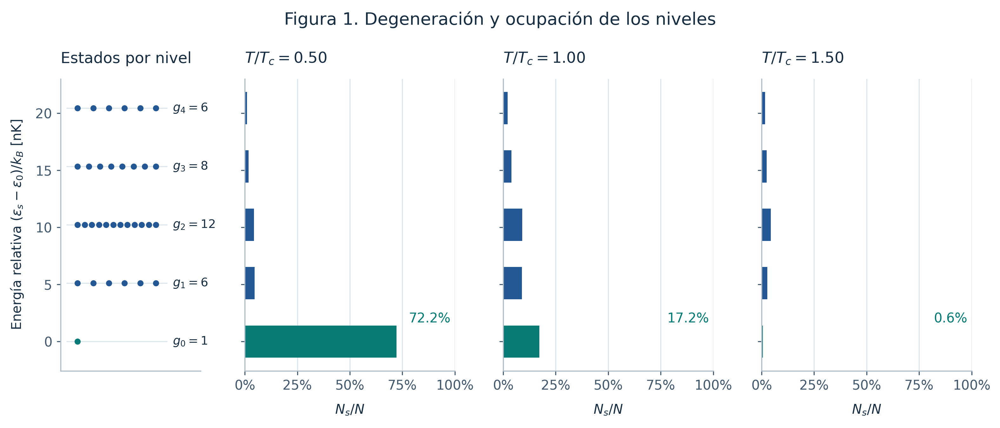
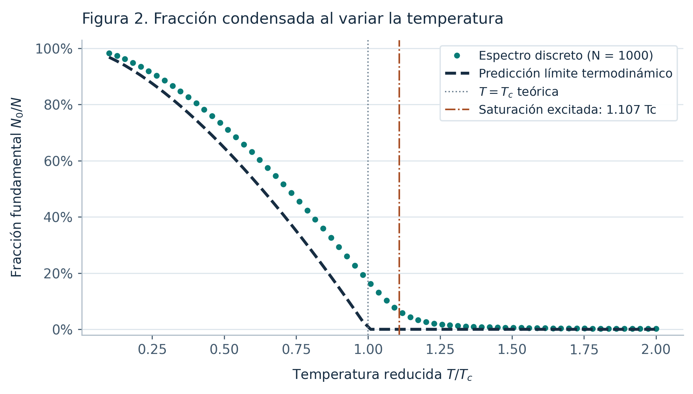
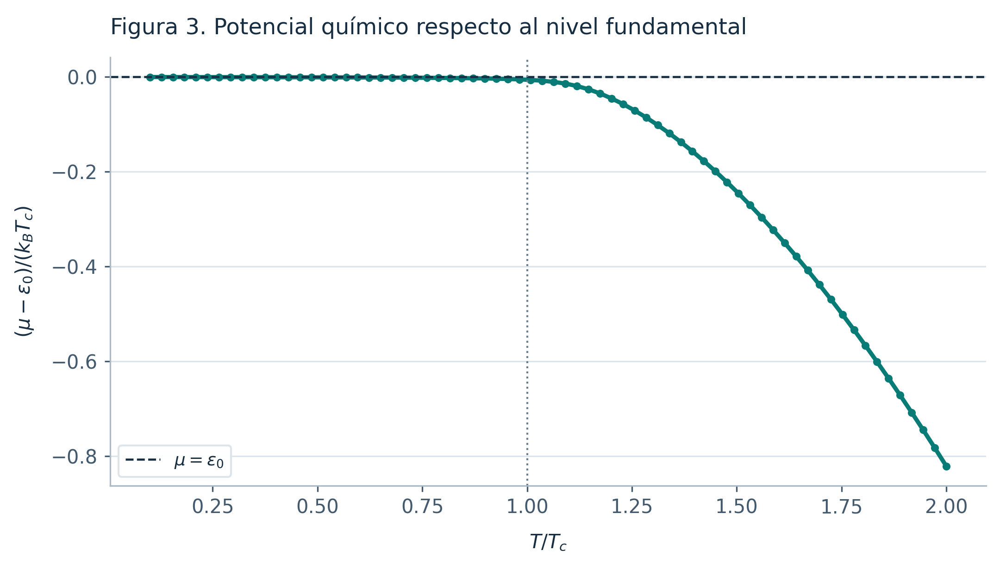
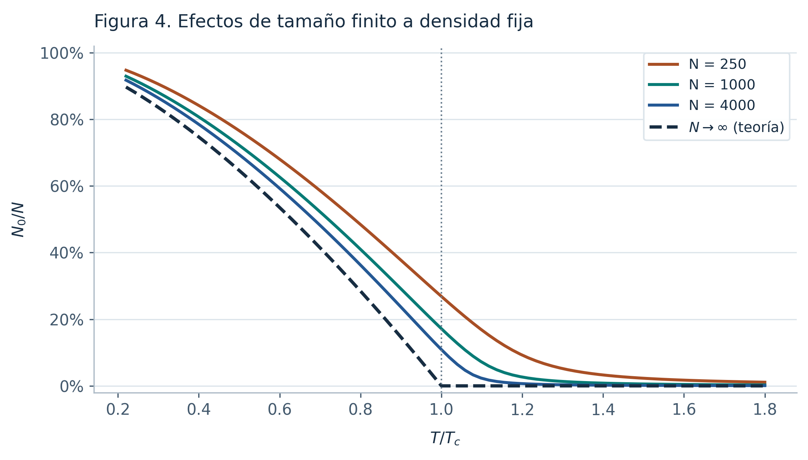
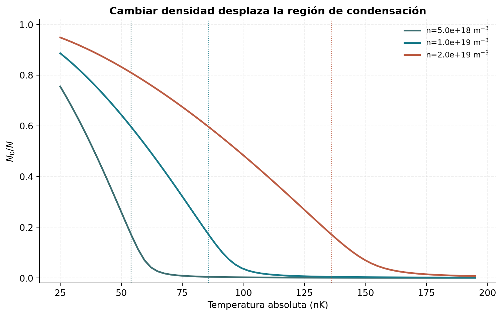
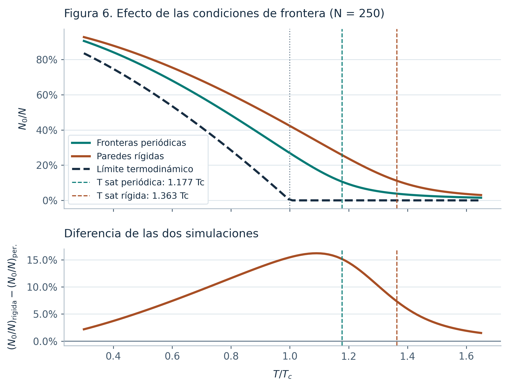
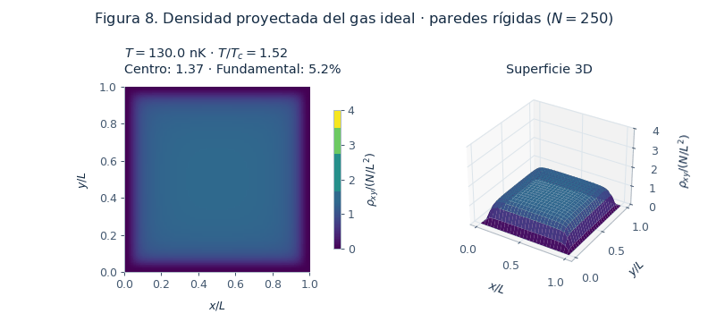

# Miniproyecto 2 — Condensación de Bose–Einstein

**Jerónimo López** · Física Estadística 2026-II

Facultad de Ciencias Exactas y Naturales, Universidad de Antioquia

## 1. ¿Qué pide la guía?

> ¿Se puede observar en una simulación que, al enfriar un gas ideal de bosones, una fracción importante de las partículas ocupa el estado fundamental?

La guía pide mostrar cómo cambia la población de los niveles de energía, estimar una temperatura característica del cruce, estudiar el efecto del tamaño o la densidad y comparar los resultados con el límite termodinámico. También pide formular y responder una pregunta propia. La entrega reúne el código, las gráficas y su interpretación en el [notebook](Miniproyecto2_BEC.ipynb).

## 2. ¿Qué se hizo y cómo se hizo?

El caso principal considera fronteras periódicas, $N=1000$ bosones y una densidad de $10^{19}\,\mathrm{m}^{-3}$. El volumen es $10^{-16}\,\mathrm{m}^3$ y el lado de la caja mide aproximadamente $4{,}64\,\mu\mathrm{m}$. La masa aproximada del rubidio-87 fija la escala de energía y temperatura. El estudio se centra en las ocupaciones de un gas ideal en la caja y su comparación con el límite termodinámico.

1. Se construyen los niveles de energía permitidos por la caja y se cuenta cuántos estados comparten cada energía.
2. A cada temperatura se calcula la ocupación media de esos estados con la estadística de Bose–Einstein. El método de Brent ajusta el potencial químico $\mu$ hasta que la suma de las ocupaciones medias coincide con $N$.
3. Se obtiene la fracción del fundamental, $N_0/N$, y se repite el cálculo al cambiar la temperatura, el tamaño, la densidad o la frontera.

La curva simulada sale de la suma de los niveles discretos. La $T_c$ teórica sirve como escala de temperatura, y la curva del límite termodinámico se superpone para comparar. La temperatura de saturación $T_{\mathrm{sat}}$ se obtiene por separado de la suma de ocupaciones excitadas.

En el barrido principal se incluyeron **454 niveles y 52 923 estados**. El error máximo en la suma de ocupaciones fue de $1{,}24\times10^{-8}$ partículas. A la temperatura más alta del barrido, aumentar el factor de corte de 18 a 24 cambió la fracción del fundamental en $3{,}30\times10^{-10}$.

## 3. ¿Qué se responde con los resultados?

### ¿Cómo se redistribuyen las partículas al enfriar y qué pasa con el fundamental?

Al enfriar de $1{,}5T_c$ a $0{,}5T_c$, la fracción en el estado fundamental aumenta de **0,57 % a 72,21 %**. La Figura 1 muestra el reparto en los primeros niveles a tres temperaturas y la Figura 2 sigue la ocupación del fundamental en todo el barrido.





### ¿Se puede identificar una temperatura característica?

Para la densidad del caso principal, la temperatura crítica teórica es $T_c=85{,}73\,\mathrm{nK}$. En la caja finita, la fracción condensada cambia gradualmente. La máxima pendiente se encuentra cerca de $0{,}926T_c$ y la capacidad de los niveles excitados iguala el número total de partículas a $T_{\mathrm{sat}}=1{,}107T_c$, aproximadamente $94{,}92\,\mathrm{nK}$. Estos dos indicadores ubican la región de cruce en la caja finita. Al enfriar, el potencial químico se acerca a la energía del fundamental desde abajo.



### ¿Qué cambia con el tamaño y la densidad?

Al aumentar $N$ a densidad fija, se reduce la diferencia con la curva teórica y $T_{\mathrm{sat}}/T_c$ se acerca a 1.

| $N$ | $N_0/N$ a $T_c$ | Error RMS frente al límite | $T_{\mathrm{sat}}/T_c$ |
|---:|---:|---:|---:|
| 250 | 26,86 % | 0,1323 | 1,1774 |
| 1000 | 17,16 % | 0,0791 | 1,1073 |
| 4000 | 10,90 % | 0,0478 | 1,0658 |



Al mantener $N=1000$ y aumentar la densidad, la fracción condensada empieza a crecer a temperaturas más altas. La referencia teórica sigue $T_c\propto n^{2/3}$. Los volúmenes críticos se obtienen al despejar esa misma relación y calcular $V_c=N/n_c(T)$. Los valores de la tabla son referencias teóricas para los tres casos de densidad.

| Densidad crítica ($\mathrm{m}^{-3}$) | $T$ (nK) | $V_c$ ($\mu\mathrm{m}^3$) |
|---:|---:|---:|
| $5\times10^{18}$ | 54,01 | 200 |
| $1\times10^{19}$ | 85,73 | 100 |
| $2\times10^{19}$ | 136,08 | 50 |



### ¿Cómo se compara la simulación con el límite termodinámico?

En el caso principal de $N=1000$ y fronteras periódicas, las ocupaciones calculadas se comparan con la curva del gas ideal en el límite termodinámico. La mayor diferencia de la tabla aparece en $T=T_c$. Allí, la caja finita todavía tiene un 17,16 % de las partículas en el fundamental y la predicción para el límite termodinámico es cero.

| $T/T_c$ | $N_0/N$ calculado | $N_0/N$ teórico | Diferencia (puntos porcentuales) |
|---:|---:|---:|---:|
| 0,50 | 72,21 % | 64,65 % | 7,56 |
| 0,80 | 40,98 % | 28,45 % | 12,53 |
| 1,00 | 17,16 % | 0,00 % | 17,16 |
| 1,20 | 2,64 % | 0,00 % | 2,64 |
| 1,50 | 0,57 % | 0,00 % | 0,57 |

## 4. Pregunta propia sobre las fronteras

> A igual número de partículas, volumen y temperatura, ¿cómo cambian la fracción condensada y la densidad espacial al pasar de fronteras periódicas a paredes rígidas?

Para responder se calcula la ocupación en ambos espectros con $N=250$. Las paredes rígidas elevan la fracción del fundamental y la temperatura de saturación en el caso estudiado. En todo el barrido, la diferencia máxima de $N_0/N$ entre las dos fronteras es de **16,20 puntos porcentuales**.

| Condición de frontera | $N_0/N$ a $T_c$ | $T_{\mathrm{sat}}$ (nK) |
|---|---:|---:|
| Periódica | 26,86 % | 100,94 |
| Paredes rígidas | 42,31 % | 116,88 |



La Figura 7 muestra que las dos fronteras producen un pico en el centro del espacio de momentos.


La animación muestra la densidad proyectada en el espacio físico. En la caja periódica, el perfil es uniforme. Con paredes rígidas, la densidad proyectada en el centro pasa de **1,37 a 3,57 veces su valor medio** al enfriar de 130 a 40 nK. La celda de la sección 3.7.2 permite elegir la frontera y la escala de temperatura.



## 5. Conclusión

La simulación muestra que, al enfriar el gas, una fracción importante de los bosones pasa a ocupar el estado fundamental. En la caja finita ese cambio es gradual y se acerca a la predicción termodinámica al aumentar el tamaño a densidad fija. La comparación de fronteras muestra además que una ocupación alta del fundamental puede coexistir con una densidad espacial uniforme, como ocurre en la caja periódica.

## Material de la presentación

Se pueden consultar el [notebook](Miniproyecto2_BEC.ipynb) y su [versión HTML](Miniproyecto2_BEC.html). El notebook se abre en VS Code con la extensión Jupyter o en JupyterLab. Para volver a calcular los resultados principales, se instalan las dependencias y se ejecutan las celdas en orden hasta la sección 4.

```powershell
python -m pip install -r requirements.txt
```

Las figuras se guardan en `figuras/`. La sección 3.4 exporta los CSV con el barrido principal, la comparación teórica y la comprobación del corte de energía.

El proyecto se basa en el enunciado del Miniproyecto 2 de Física Estadística y en *Física Estadística: Teoría, Algoritmos y Problemas*, de Johans Restrepo Cárdenas (2026).
